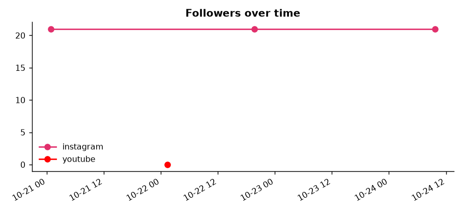
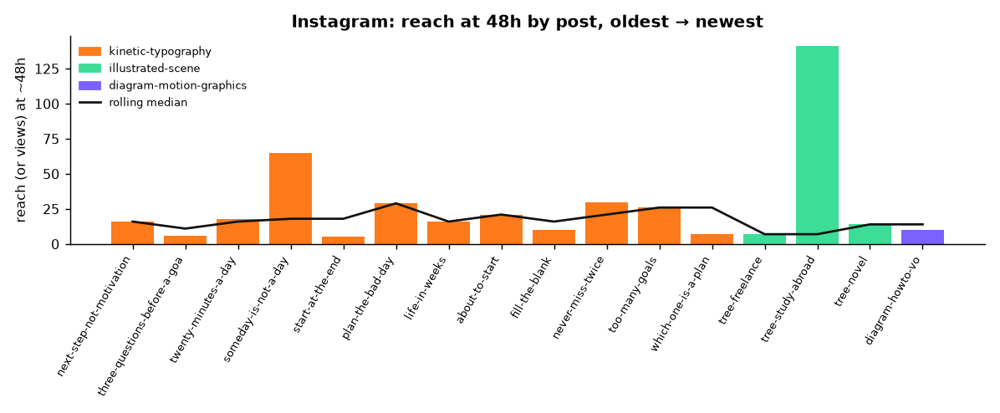
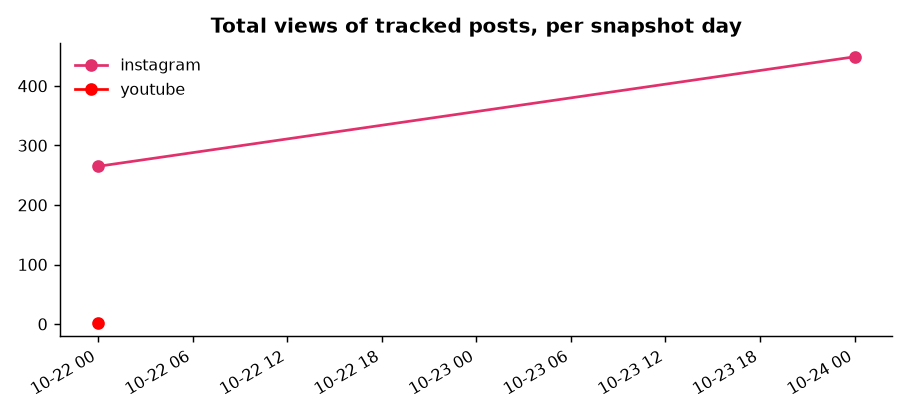
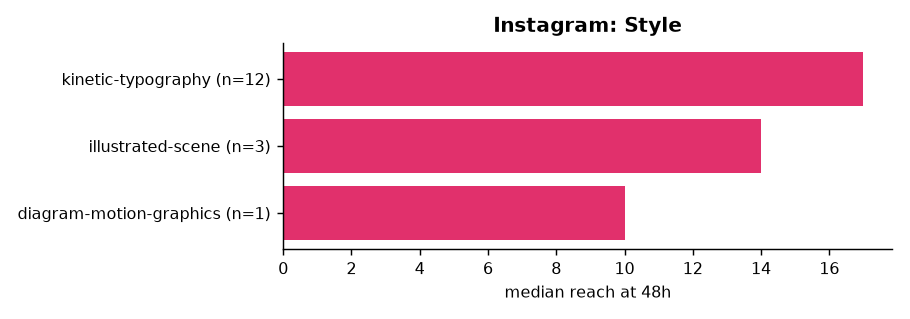
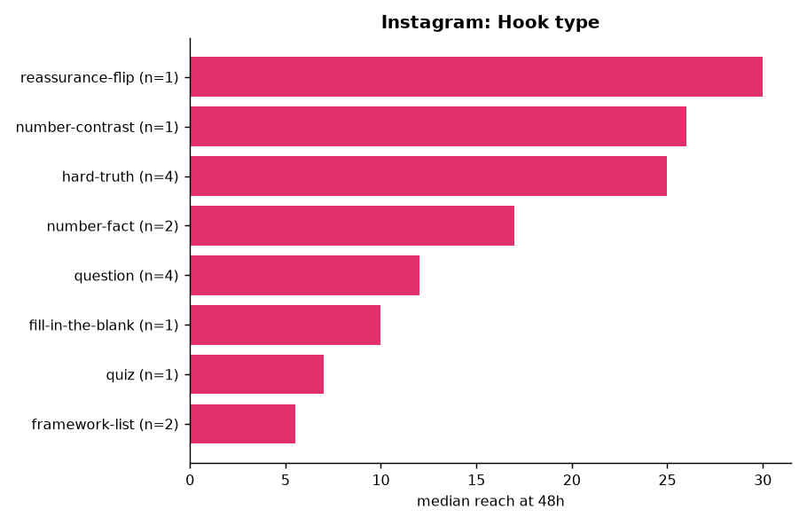
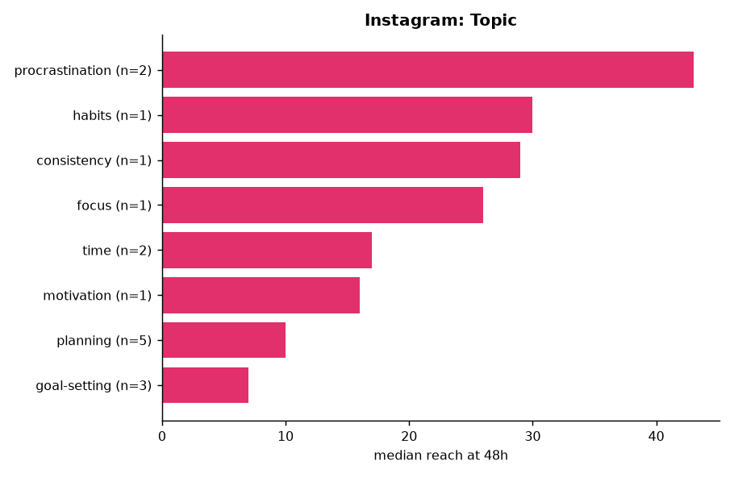
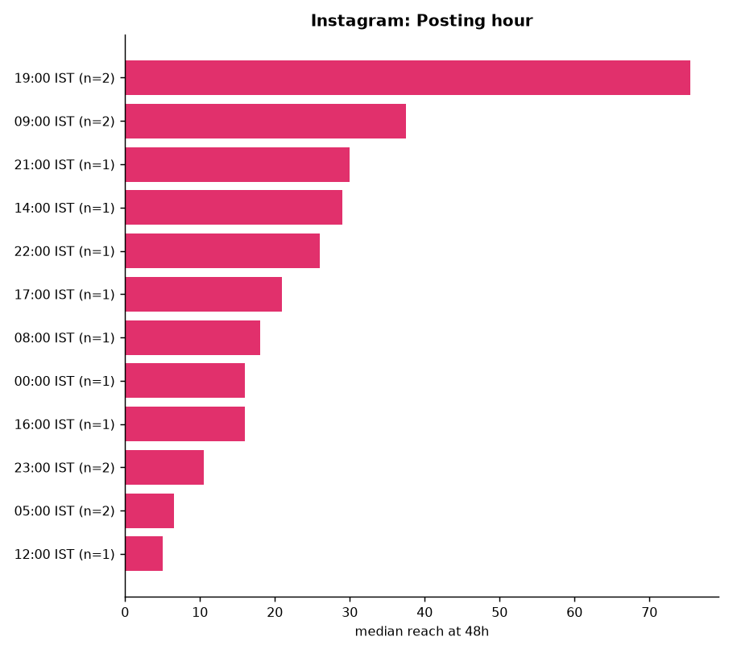
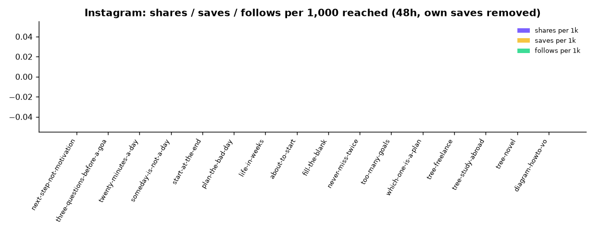

# Content performance: overall

_Last rebuilt 2026-10-24 09:36 IST from 3 snapshot day(s) and 27 tracked post(s). Start here. Raw data lives in `daily/<date>/`, post traits in `catalog/content.csv`, definitions in [METRICS.md](../METRICS.md)._

## Headline

| Platform | Followers now | Change (first → latest reading) | Posts tracked | Posts with 48h data | Median reach at 48h | Best post (traction) |
|---|---|---|---|---|---|---|
| instagram | 21 | 21 → 21 (+0) | 17 | 16 | 16 | tree-study-abroad (75) |
| youtube | 0 | 0 → 0 (+0) | 10 | 0 | – | – |
| x | – | – | 0 | 0 | – | – |

## Are we improving?

- **instagram**: newer half of posts median reach 12 vs older half 17 → **declining**.

## Charts

### Followers over time (are we growing?)

### Instagram: reach at 48h per post, in posting order (bars coloured by style)

### Total views across tracked posts, per snapshot day

### Instagram: median reach at 48h by style

### Instagram: median reach at 48h by hook type

### Instagram: median reach at 48h by topic

### Instagram: median reach at 48h by posting hour

### Instagram: shares, saves and follows per 1,000 reached

## Leaderboard (48h checkpoint)

### Instagram

| # | Post | Posted (IST) | Style | Hook | Reach 48h | Retention % | Shares+saves /1k | Follows /1k | Traction |
|---|---|---|---|---|---|---|---|---|---|
| 1 | [tree-study-abroad](https://www.instagram.com/reel/DezJblYzfye/) | 2026-10-22 19:30 | illustrated-scene | question | 141 | – | 0.0 | 0.0 | 75 |
| 2 | [someday-is-not-a-day](https://www.instagram.com/reel/Devf-yOz9AS/) | 2026-10-21 09:30 | kinetic-typography | hard-truth | 65 | – | 0.0 | 0.0 | 72 |
| 3 | [never-miss-twice](https://www.instagram.com/reel/DewyWMxzwg1/) | 2026-10-21 21:30 | kinetic-typography | reassurance-flip | 30 | – | 0.0 | 0.0 | 68 |
| 4 | [plan-the-bad-day](https://www.instagram.com/reel/DewCV5ATeLJ/) | 2026-10-21 14:30 | kinetic-typography | hard-truth | 29 | – | 0.0 | 0.0 | 65 |
| 5 | [too-many-goals](https://www.instagram.com/reel/Dew5OYwTJZK/) | 2026-10-21 22:30 | kinetic-typography | number-contrast | 26 | – | 0.0 | 0.0 | 62 |
| 6 | [about-to-start](https://www.instagram.com/reel/DewW-D0TzPm/) | 2026-10-21 17:30 | kinetic-typography | hard-truth | 21 | – | 0.0 | 0.0 | 58 |
| 7 | [twenty-minutes-a-day](https://www.instagram.com/reel/DevZFYvz8iS/) | 2026-10-21 08:30 | kinetic-typography | number-fact | 18 | – | 0.0 | 0.0 | 55 |
| 8 | [next-step-not-motivation](https://www.instagram.com/reel/DeulBhStyuO/) | 2026-10-21 00:54 | kinetic-typography | hard-truth | 16 | – | 0.0 | 0.0 | 50 |
| 9 | [life-in-weeks](https://www.instagram.com/reel/DewQFg0TZfs/) | 2026-10-21 16:30 | kinetic-typography | number-fact | 16 | – | 0.0 | 0.0 | 50 |
| 10 | [tree-novel](https://www.instagram.com/reel/Dezk97kTy37/) | 2026-10-22 23:30 | illustrated-scene | question | 14 | – | 0.0 | 0.0 | 45 |
| 11 | [fill-the-blank](https://www.instagram.com/reel/Dewkt5bTJJ1/) | 2026-10-21 19:30 | kinetic-typography | fill-in-the-blank | 10 | – | 0.0 | 0.0 | 40 |
| 12 | [diagram-howto-vo](https://www.instagram.com/reel/De0pmqQTJ3O/) | 2026-10-23 09:30 | diagram-motion-graphics | question | 10 | – | 0.0 | 0.0 | 40 |
| 13 | [which-one-is-a-plan](https://www.instagram.com/reel/DexAG3sTNN-/) | 2026-10-21 23:30 | kinetic-typography | quiz | 7 | – | 0.0 | 0.0 | 33 |
| 14 | [tree-freelance](https://www.instagram.com/reel/DexpYG0zBz4/) | 2026-10-22 05:30 | illustrated-scene | question | 7 | – | 0.0 | 0.0 | 33 |
| 15 | [three-questions-before-a-goal](https://www.instagram.com/reel/DevEkV9T33l/) | 2026-10-21 05:30 | kinetic-typography | framework-list | 6 | – | 0.0 | 0.0 | 28 |
| 16 | [start-at-the-end](https://www.instagram.com/reel/Dev0ly8T2f8/) | 2026-10-21 12:30 | kinetic-typography | framework-list | 5 | – | 0.0 | 0.0 | 25 |

## Too early to judge (no 48h reading yet)

| Post | Platform | Posted (IST) | Latest age (h) | Latest views |
|---|---|---|---|---|
| next-step-not-motivation | youtube | 2026-10-21 23:45 | 2 | 0 |
| three-questions-before-a-goal | youtube | 2026-10-21 23:52 | 2 | 0 |
| twenty-minutes-a-day | youtube | 2026-10-22 00:00 | 1 | 2 |
| someday-is-not-a-day | youtube | 2026-10-22 00:20 | 1 | 0 |
| start-at-the-end | youtube | 2026-10-22 00:30 | 1 | 0 |
| plan-the-bad-day | youtube | 2026-10-22 00:38 | 1 | 0 |
| life-in-weeks | youtube | 2026-10-22 00:46 | 1 | 0 |
| about-to-start | youtube | 2026-10-22 00:54 | 0 | 0 |
| fill-the-blank | youtube | 2026-10-22 01:02 | 0 | 0 |
| never-miss-twice | youtube | 2026-10-22 01:10 | 0 | 0 |
| diagram-someday-vo | instagram | 2026-10-23 19:30 | 14 | 27 |

## Data gaps

- 16 post(s) have no retention (watch time) data: Instagram web insights do not show it; get app screenshots.
- In catalog but never measured: x:diagram-howto-vo, x:diagram-someday-vo.

See [WHAT_WORKED.md](WHAT_WORKED.md) for trait-by-trait comparisons and [latest_by_post.csv](latest_by_post.csv) for every number in one table.

