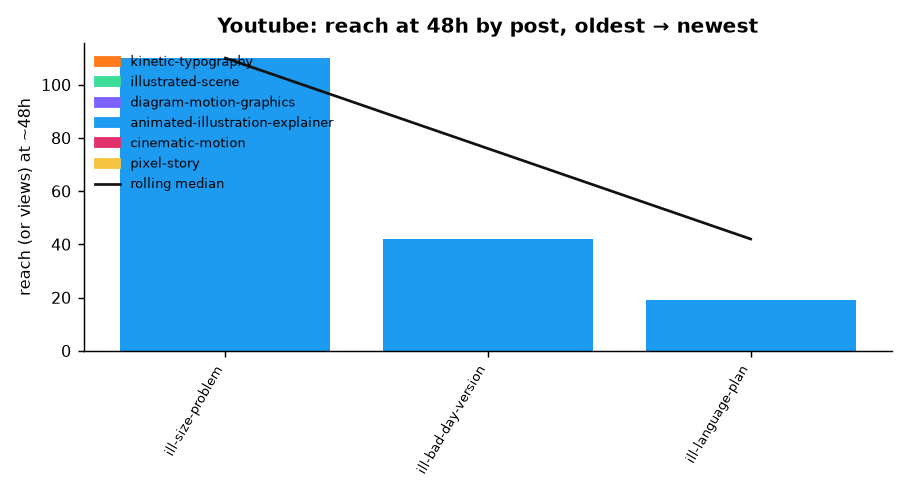
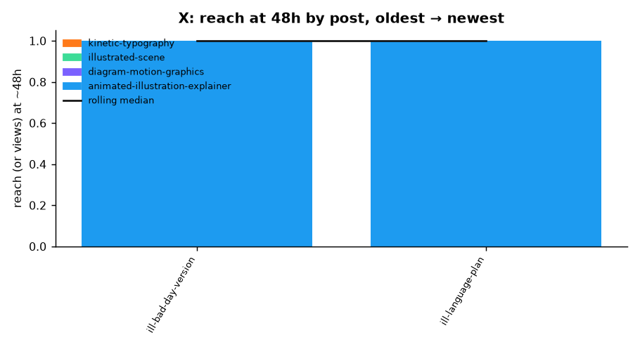
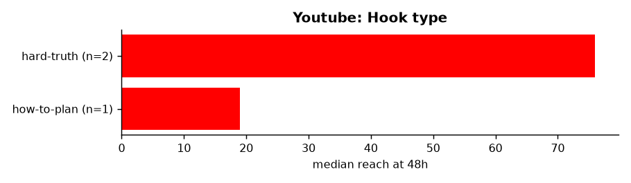
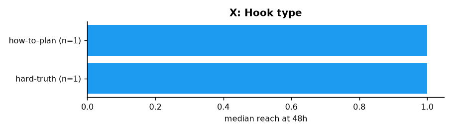
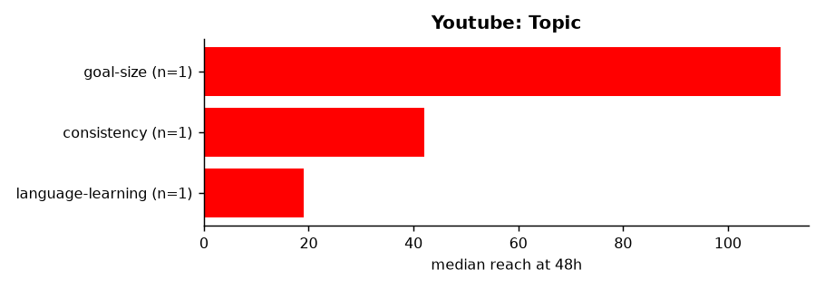
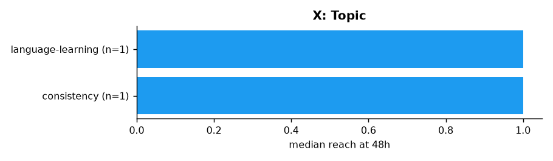
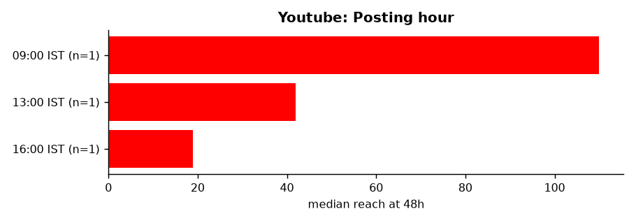
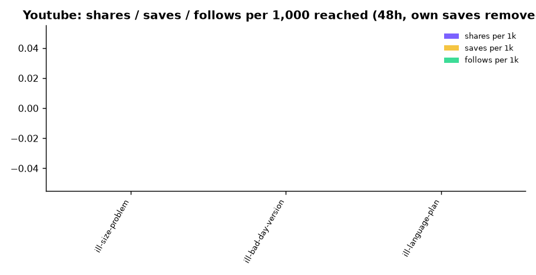
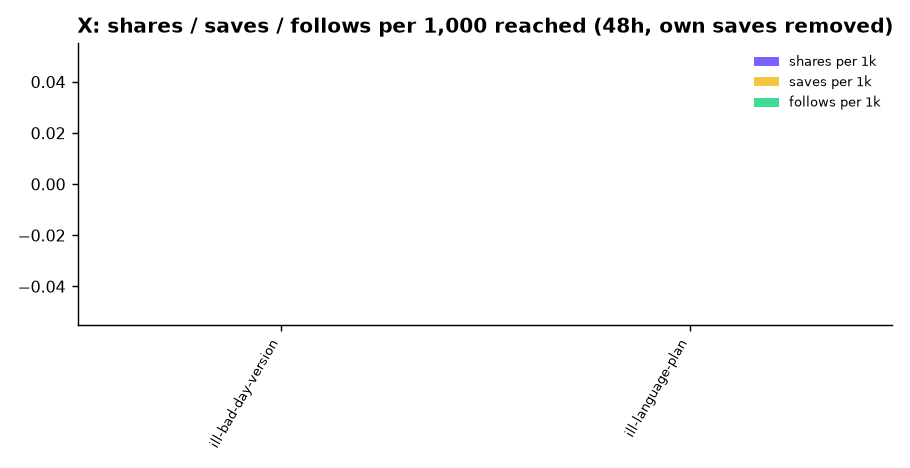

# Content performance: overall

_Last rebuilt 2026-10-29 09:02 IST from 5 snapshot day(s) and 52 tracked post(s). Start here. Raw data lives in `daily/<date>/`, post traits in `catalog/content.csv`, definitions in [METRICS.md](../METRICS.md)._

## Headline

| Platform | Followers now | Change (first → latest reading) | Posts tracked | Posts with 48h data | Median reach at 48h | Best post (traction) |
|---|---|---|---|---|---|---|
| instagram | 21 | 21 → 21 (+0) | 31 | 27 | 29 | ill-track-inputs (87) |
| youtube | 0 | 0 → 0 (+0) | 17 | 3 | 42 | ill-size-problem (68) |
| x | 2 | 2 → 2 (+0) | 4 | 2 | 1 | ill-language-plan (50) |

## Are we improving?

- **instagram**: newer half of posts median reach 92 vs older half 16 → **improving**.
- **youtube**: only 3 post(s) with 48h data; need 4+ for a trend.
- **x**: only 2 post(s) with 48h data; need 4+ for a trend.

## Charts

### Followers over time (are we growing?)

### Instagram: reach at 48h per post, in posting order (bars coloured by style)

### Youtube: reach at 48h per post, in posting order (bars coloured by style)

### X: reach at 48h per post, in posting order (bars coloured by style)

### Total views across tracked posts, per snapshot day

### Instagram: median reach at 48h by style

### Instagram: median reach at 48h by hook type

### Youtube: median reach at 48h by hook type

### X: median reach at 48h by hook type

### Instagram: median reach at 48h by topic

### Youtube: median reach at 48h by topic

### X: median reach at 48h by topic

### Instagram: median reach at 48h by posting hour

### Youtube: median reach at 48h by posting hour

### X: median reach at 48h by posting hour

### Instagram: shares, saves and follows per 1,000 reached

### Youtube: shares, saves and follows per 1,000 reached

### X: shares, saves and follows per 1,000 reached

## Leaderboard (48h checkpoint)

### Instagram

| # | Post | Posted (IST) | Style | Hook | Reach 48h | Retention % | Shares+saves /1k | Follows /1k | Traction |
|---|---|---|---|---|---|---|---|---|---|
| 1 | [ill-track-inputs](https://www.instagram.com/reel/De9IEdqzGDC/) | 2026-10-26 16:30 | animated-illustration-explainer | hard-truth | 223 | – | 9.0 | 0.0 | 87 |
| 2 | [ill-size-problem](https://www.instagram.com/reel/De5zI6YTeeV/) | 2026-10-25 09:30 | animated-illustration-explainer | hard-truth | 272 | – | 0.0 | 0.0 | 75 |
| 3 | [ill-later-trigger](https://www.instagram.com/reel/De8v_dwzUDu/) | 2026-10-26 13:00 | animated-illustration-explainer | hard-truth | 203 | – | 0.0 | 0.0 | 71 |
| 4 | [tree-study-abroad](https://www.instagram.com/reel/DezJblYzfye/) | 2026-10-22 19:30 | illustrated-scene | question | 141 | – | 0.0 | 0.0 | 69 |
| 5 | [ill-bad-day-version](https://www.instagram.com/reel/De6LNpMTDf7/) | 2026-10-25 13:00 | animated-illustration-explainer | hard-truth | 128 | – | 0.0 | 0.0 | 67 |
| 6 | pixel-book | 2026-10-27 23:55 | pixel-story | story | 127 | – | 0.0 | 0.0 | 65 |
| 7 | [ill-monday-wont-fix-it](https://www.instagram.com/reel/De633j1TDG9/) | 2026-10-25 19:30 | animated-illustration-explainer | hard-truth | 118 | – | 0.0 | 0.0 | 63 |
| 8 | [ill-night-before](https://www.instagram.com/reel/De8X8KzzMBa/) | 2026-10-26 09:30 | animated-illustration-explainer | hard-truth | 67 | – | 0.0 | 0.0 | 61 |
| 9 | [someday-is-not-a-day](https://www.instagram.com/reel/Devf-yOz9AS/) | 2026-10-21 09:30 | kinetic-typography | hard-truth | 65 | – | 0.0 | 0.0 | 59 |
| 10 | [ill-language-plan](https://www.instagram.com/reel/De6jQagTCom/) | 2026-10-25 16:30 | animated-illustration-explainer | how-to-plan | 46 | – | 0.0 | 0.0 | 57 |
| 11 | [diagram-someday-vo](https://www.instagram.com/reel/De1uUEGzH1P/) | 2026-10-23 19:30 | diagram-motion-graphics | hard-truth | 39 | – | 0.0 | 0.0 | 55 |
| 12 | [never-miss-twice](https://www.instagram.com/reel/DewyWMxzwg1/) | 2026-10-21 21:30 | kinetic-typography | reassurance-flip | 30 | – | 0.0 | 0.0 | 52 |
| 13 | brand-one-place | 2026-10-26 22:00 | cinematic-motion | relatable | 30 | – | 0.0 | 0.0 | 52 |
| 14 | [plan-the-bad-day](https://www.instagram.com/reel/DewCV5ATeLJ/) | 2026-10-21 14:30 | kinetic-typography | hard-truth | 29 | – | 0.0 | 0.0 | 50 |
| 15 | ill-five-goals | 2026-10-26 19:30 | animated-illustration-explainer | hard-truth | 27 | – | 0.0 | 0.0 | 48 |
| 16 | [too-many-goals](https://www.instagram.com/reel/Dew5OYwTJZK/) | 2026-10-21 22:30 | kinetic-typography | number-contrast | 26 | – | 0.0 | 0.0 | 46 |
| 17 | [about-to-start](https://www.instagram.com/reel/DewW-D0TzPm/) | 2026-10-21 17:30 | kinetic-typography | hard-truth | 21 | – | 0.0 | 0.0 | 44 |
| 18 | [twenty-minutes-a-day](https://www.instagram.com/reel/DevZFYvz8iS/) | 2026-10-21 08:30 | kinetic-typography | number-fact | 18 | – | 0.0 | 0.0 | 42 |
| 19 | [next-step-not-motivation](https://www.instagram.com/reel/DeulBhStyuO/) | 2026-10-21 00:54 | kinetic-typography | hard-truth | 16 | – | 0.0 | 0.0 | 39 |
| 20 | [life-in-weeks](https://www.instagram.com/reel/DewQFg0TZfs/) | 2026-10-21 16:30 | kinetic-typography | number-fact | 16 | – | 0.0 | 0.0 | 39 |
| 21 | [tree-novel](https://www.instagram.com/reel/Dezk97kTy37/) | 2026-10-22 23:30 | illustrated-scene | question | 14 | – | 0.0 | 0.0 | 36 |
| 22 | [fill-the-blank](https://www.instagram.com/reel/Dewkt5bTJJ1/) | 2026-10-21 19:30 | kinetic-typography | fill-in-the-blank | 10 | – | 0.0 | 0.0 | 33 |
| 23 | [diagram-howto-vo](https://www.instagram.com/reel/De0pmqQTJ3O/) | 2026-10-23 09:30 | diagram-motion-graphics | question | 10 | – | 0.0 | 0.0 | 33 |
| 24 | [which-one-is-a-plan](https://www.instagram.com/reel/DexAG3sTNN-/) | 2026-10-21 23:30 | kinetic-typography | quiz | 7 | – | 0.0 | 0.0 | 29 |
| 25 | [tree-freelance](https://www.instagram.com/reel/DexpYG0zBz4/) | 2026-10-22 05:30 | illustrated-scene | question | 7 | – | 0.0 | 0.0 | 29 |
| 26 | [three-questions-before-a-goal](https://www.instagram.com/reel/DevEkV9T33l/) | 2026-10-21 05:30 | kinetic-typography | framework-list | 6 | – | 0.0 | 0.0 | 26 |
| 27 | [start-at-the-end](https://www.instagram.com/reel/Dev0ly8T2f8/) | 2026-10-21 12:30 | kinetic-typography | framework-list | 5 | – | 0.0 | 0.0 | 24 |

### Youtube

| # | Post | Posted (IST) | Style | Hook | Reach 48h | Retention % | Shares+saves /1k | Follows /1k | Traction |
|---|---|---|---|---|---|---|---|---|---|
| 1 | [ill-size-problem](https://youtube.com/shorts/U8PvH17xm-k) | 2026-10-25 09:30 | animated-illustration-explainer | hard-truth | 110 | – | 0.0 | 0.0 | 68 |
| 2 | [ill-bad-day-version](https://youtube.com/shorts/g1Ri7WMhaG4) | 2026-10-25 13:00 | animated-illustration-explainer | hard-truth | 42 | – | 0.0 | 0.0 | 50 |
| 3 | ill-language-plan | 2026-10-25 16:30 | animated-illustration-explainer | how-to-plan | 19 | – | 0.0 | 0.0 | 32 |

### X

| # | Post | Posted (IST) | Style | Hook | Reach 48h | Retention % | Shares+saves /1k | Follows /1k | Traction |
|---|---|---|---|---|---|---|---|---|---|
| 1 | ill-language-plan | 2026-10-25 16:30 | animated-illustration-explainer | how-to-plan | 1 | – | 0.0 | 0.0 | 50 |
| 2 | ill-bad-day-version | 2026-10-25 13:00 | animated-illustration-explainer | hard-truth | 1 | – | 0.0 | 0.0 | 50 |

## Too early to judge (no 48h reading yet)

| Post | Platform | Posted (IST) | Latest age (h) | Latest views |
|---|---|---|---|---|
| next-step-not-motivation | youtube | 2026-10-21 23:45 | 114 | 8 |
| three-questions-before-a-goal | youtube | 2026-10-21 23:52 | 114 | 8 |
| twenty-minutes-a-day | youtube | 2026-10-22 00:00 | 114 | 15 |
| someday-is-not-a-day | youtube | 2026-10-22 00:20 | 113 | 0 |
| start-at-the-end | youtube | 2026-10-22 00:30 | 113 | 0 |
| plan-the-bad-day | youtube | 2026-10-22 00:38 | 113 | 0 |
| life-in-weeks | youtube | 2026-10-22 00:46 | 113 | 1 |
| about-to-start | youtube | 2026-10-22 00:54 | 113 | 0 |
| fill-the-blank | youtube | 2026-10-22 01:02 | 112 | 0 |
| never-miss-twice | youtube | 2026-10-22 01:10 | 112 | 0 |
| ill-monday-wont-fix-it | youtube | 2026-10-25 19:30 | 22 | 0 |
| ill-monday-wont-fix-it | x | 2026-10-25 19:30 | 22 | 1 |
| ill-night-before | youtube | 2026-10-26 09:30 | 8 | 5 |
| ill-night-before | x | 2026-10-26 09:30 | 8 | 1 |
| ill-later-trigger | youtube | 2026-10-26 13:00 | 4 | 5 |
| ill-track-inputs | youtube | 2026-10-26 16:30 | 1 | 0 |
| ill-save-first | instagram | 2026-10-28 09:30 | 14 | 35 |
| ill-career-conversations | instagram | 2026-10-28 13:00 | 11 | 54 |
| ill-goal-date | instagram | 2026-10-28 16:30 | 7 | 7 |
| ill-phone-distance | instagram | 2026-10-28 19:30 | 4 | 72 |

## Data gaps

- 32 post(s) have no retention (watch time) data: Instagram web insights do not show it; get app screenshots.
- In catalog but never measured: x:diagram-howto-vo, x:diagram-someday-vo, x:ill-size-problem, x:ill-later-trigger, x:ill-track-inputs, x:ill-five-goals, youtube:ill-five-goals, x:brand-one-place, youtube:brand-one-place, x:pixel-book, youtube:pixel-book, x:ill-save-first, youtube:ill-save-first, x:ill-career-conversations, youtube:ill-career-conversations, x:ill-goal-date, youtube:ill-goal-date, x:ill-phone-distance, youtube:ill-phone-distance, instagram:ill-unclear-task, x:ill-unclear-task, youtube:ill-unclear-task, instagram:ill-ten-pages, x:ill-ten-pages, youtube:ill-ten-pages, instagram:ill-gym-day-four, x:ill-gym-day-four, youtube:ill-gym-day-four, instagram:ill-one-category, x:ill-one-category, youtube:ill-one-category, instagram:ill-one-sentence, x:ill-one-sentence, youtube:ill-one-sentence, x:ill-hard-part, youtube:ill-hard-part.

See [WHAT_WORKED.md](WHAT_WORKED.md) for trait-by-trait comparisons and [latest_by_post.csv](latest_by_post.csv) for every number in one table.

